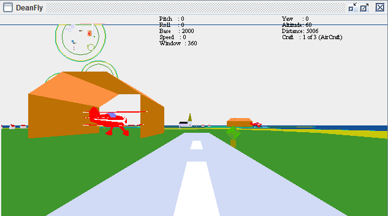
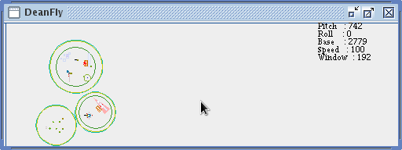
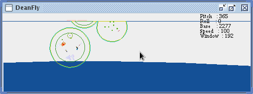
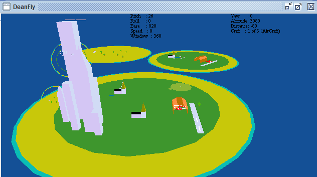
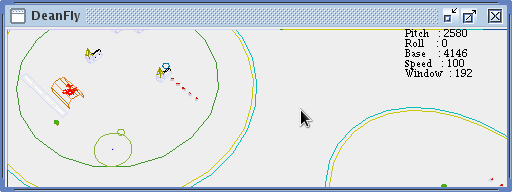

DeanFly
======================= 

3D graphics educational rudimental flight simulator to illustrate concepts such as Clipping, Perspective, Hidden Surface Removal, Double Buffering etc.
This is by no means a polished product and should be used only to demonstrate the some of the concepts used within 3D graphics programming.  This software was originally developed in C++ during a 3D Graphics module for a BSc Computing for Real-Time Systems degree and the University of the West of England UWE.  This Watcom C++ source was later ported to Java purely as a learning exercise.  Minor changes have been made since this was ported to enable compilation under modern Java (now built with Gradle on JDK 25).

View from Field 1: 

Controls
-----------

* S	Start (from the title screen)
* Q	Quit (Second Q will exit the application)
* C	Continue following a quit

Aircraft (islandWorld):

* +/-	Speed
* a	Roll Left
* d	Roll Right
* s	Nose Up
* w	Nose Down

Walker (cubeWorld):

* w	Step back
* s	Step forward
* a	Turn left
* d	Turn right

The numeric keypad 2/4/6/8 also works for pitch and roll (aircraft) or walk and turn (walker).

* i	Instrumentation
* k	Key help (this list on screen)
* m	map
* M	Clip Map

Cheat Controls
-----------
* '.'	High above the islands
* '[' 	Back to the start position
* v or ]	Scroll between each view / vehicle
* N	North
* E	East
* S	South
* W	West
* (	Decrease altitude
* )	Increase altitude

* Mouse Left button	move to start position
* Mouse Right button	move to in flight position
* Mouse Center button	High Altitude, nose down

3D Educational Controls
-----------
* b	Fill/Wireframe mode
* c	Clipping on/off
* C	Screen Clipping on/off
* h	Hidden Surface Removal
* f	Flip the view
* p	Perspective on/off

Map Views
-----------

The Map: 

The Clip Map: 

In Flight
-----------

View from High Altitude: 

Wireframe View
-----------

Wireframe View from Field 1: 

Running the application
-----------

#### Requirements
* JDK 17 or newer (built and tested with JDK 25; the Gradle toolchain is set to 25 in `build.gradle`)
* Nothing else - the Gradle wrapper downloads Gradle 9.8.2 on first use. No external libraries are needed.
* Optional: [Doxygen](https://www.doxygen.nl) (and Graphviz) to build the documentation

#### To compile:

*     ./gradlew build        (Windows: gradlew.bat build)

This produces `build/libs/DeanFly.jar`.

#### To run (must be run from the project root, the world data is loaded relative to it):

*     ./gradlew run                       (islandWorld, the default)
*     ./gradlew run -Pworld=islandWorld
*     ./gradlew run -Pworld=cubeWorld

Or directly with Java after building:

*     java -Xms1024m -cp build/classes/java/main DeanFly cubeWorld

#### Tests (headless)

*     ./gradlew test

Runs the JUnit 5 tests with no window: both worlds are loaded, rendered off-screen and driven with flight keys, and the
near-plane and screen clipping are checked (including walking forward with `w` then turning right with `d` in cubeWorld).
`./gradlew build` runs them too.

#### VS Code
Open the folder in VS Code with the "Extension Pack for Java" installed. Use the **Run and Debug** panel
("DeanFly - islandWorld" / "DeanFly - cubeWorld"), or **Terminal > Run Task** for the Gradle build, run and Doxygen tasks.

#### Documentation (Doxygen)

*     ./gradlew doxygen

Output goes to `build/doxygen/html/index.html` (the checked-in `Doxygen/html` is left untouched).

To refresh the checked-in copy (`Doxygen/html`, `Doxygen/rtf`), delete those two folders and run `doxygen lld.doxyfile` from inside the `Doxygen` folder.

#### Eclipse / NetBeans
The old Ant/NetBeans build has been removed. Import the project into Eclipse or NetBeans as a Gradle project.

#### Java version notes
The code compiles on JDK 25 with no removal warnings. The former `JApplet` base class has been replaced by `JPanel`, so
the Applet API (removed from the JDK in version 26) is no longer used. Java applets can no longer run (browsers dropped the plugin, and the Applet API is removed from the JDK in version 26),
so the old applet web pages (`web/`) have been removed. Run the game as a desktop application with the commands above.
See `CLAUDE.md` for details.
